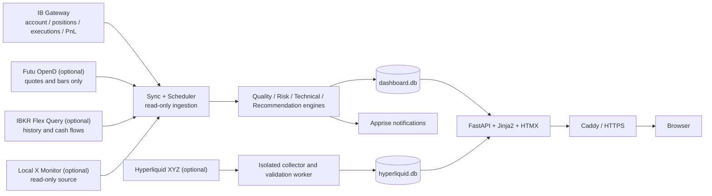

# Personal Trading Decision System (IBKR)

[English](README.md) | [简体中文](README.zh-CN.md)

[](https://github.com/datazhy/ibkr-trading-decision-system/actions/workflows/ci.yml)
[](https://github.com/datazhy/ibkr-trading-decision-system/releases)
[](https://ibkr-trading-decision-system.datazhy.chatgpt.site/demo)


[](LICENSE)

A self-hosted decision-support, risk-control, and review system for individual US equity investors. The application UI is currently Chinese and is branded **Xiaoyu Trading Desk**.

**[Project website](https://ibkr-trading-decision-system.datazhy.chatgpt.site)** · **[Synthetic public demo](https://ibkr-trading-decision-system.datazhy.chatgpt.site/demo)**

> [!NOTE]
> The public demo uses source-embedded, fabricated `SIM-*` portfolios. It does not connect to IBKR or any project API, and it has no application database or browser storage.

The system reads account, position, execution, and PnL data from Interactive Brokers, combines it with market context, technical signals, risk rules, and personal trade plans, and produces an auditable workflow:

> **Synchronize → validate → assess risk → recommend → execute manually → review**

It can recommend actions such as add, reduce, hold, stop, or avoid chasing, together with position-sizing guidance. It **never calls an order, cancellation, or funds-transfer endpoint**. Every real trade must be confirmed and executed manually at the broker.

> [!IMPORTANT]
> “Read-only” describes broker access. Watchlists, plans, journal entries, and event state are written to the local SQLite database.

## Highlights

- **Read-only IBKR synchronization** for balances, positions, orders, executions, PnL, margin, and historical bars.
- **Decision workflow** that combines portfolio risk, technical state, market regime, and existing plans into traceable recommendations.
- **Rules-based risk control** with R1–R7 rules, portfolio scoring, lifecycle-aware events, throttled notifications, and recovery alerts.
- **Opportunity discovery** with a personal watchlist, breakout/pullback scoring, risk-based sizing, and portfolio proposals.
- **Performance and reconciliation** that keeps daily, realized, unrealized, cash-flow, and return definitions separate.
- **Technical and market context** covering EMA structure, stop quality, VIX/VXN, QQQ, semiconductors, and rates.
- **Daily briefs and information feeds** using either deterministic templates or an optional OpenAI-compatible endpoint.
- **Replay and review** for events, thresholds, executions, position cycles, and point-in-time historical analysis.
- **Optional Hyperliquid XYZ shadow intelligence** isolated from the primary IBKR account path and disabled by default.
- **Operational safeguards** including freshness checks, sync provenance, watchdog recovery, heartbeat monitoring, and online backups.

## Dashboard Modules

| Module | Route | Purpose |
|---|---|---|
| Overview and decisions | `/` | Equity, PnL, risk summary, positions, recommendations, and plan entry points |
| Opportunity discovery | `/opportunities` | Watchlist, candidate scoring, scans, portfolio proposals, adoption, and forward outcomes |
| On-chain intelligence | `/hyperliquid` | XYZ mappings, wallets, signals, outcomes, validation, and data quality |
| Execution history | `/history` | Executions, order/execution/decision counts, commissions, reconciliation, and CSV export |
| Performance | `/cashflow`, `/calendar` | Cash flows, return curves, attribution, monthly calendar, and annual summary |
| Risk operations | `/events`, `/reviews` | Event timeline, acknowledgement, suppression, outcomes, and review queue |
| Technicals and rules | `/technical`, `/rules` | Technical state, stop quality, R1–R7 results, and notification history |
| Threshold research | `/performance` | Rule precision, outcome windows, backtests, and threshold evidence |
| Historical replay | `/replay` | Point-in-time replay without mutating live events or notifications |
| Daily briefs | `/briefs` | Brief content, source provenance, validation, delivery, and scheduler audit |
| X feed | `/x` | Optional local feed ingestion, daily summaries, authors, and source text |
| Journal | `/journal` | Manual notes and immutable position-cycle archives |
| Definitions | `/reference` | PnL, counting, commission, and risk-rule definitions |
| System status | `/status` | Freshness, capability health, scheduler, watchdog, and sync batches |

## Architecture



The Hyperliquid path uses a separate database and scheduler executor. Its failure does not block account synchronization or change the primary IBKR health state.

## Broker Safety Boundary

Broker access is protected in multiple layers:

1. `ib.connect(readonly=True)` enables read-only mode at the API connection.
2. `IB_READONLY=yes` enables Read-Only API in the Gateway container.
3. A dedicated read-only IBKR user is strongly recommended.
4. The application exposes no order, cancellation, exercise, or transfer route.
5. Adopting a recommendation creates local `PENDING` / `DRAFT` records only.
6. Historical replay runs in an explicit read-only execution context and sends no live notification.

## Risk Rules R1–R7

Rules are evaluated after position synchronization. Status, evidence, source batch, and notifications are recorded for auditability.

| Rule | Meaning | Default threshold |
|---|---|---|
| R1 | Single-name concentration | Market value / equity `> 30%` |
| R2 | Sector concentration | Sector market value / equity `> 40%` |
| R3 | Margin usage | Margin balance `< 0` |
| R4 | Repeated same-day risk increases | Same-symbol risk-increasing decisions `≥ 2` per day |
| R5 | Excessive monthly activity | Active decisions `> 10` per month |
| R6 | Oversized realized loss | Decision-level loss `> 2%` of equity; starts a 48-hour cooldown |
| R7 | Suggested stop reached | Price crosses the ATR/swing stop |

R6 aggregates partial fills into a decision. R7 refuses to label a position safe when quote quality is frozen, stale, or otherwise insufficient.

## Opportunity Discovery

The opportunity module targets long-only US common stocks with an expected holding period of 2–12 weeks:

1. Read the personal watchlist.
2. Gate on completeness, price, liquidity, market regime, and stop quality.
3. Score trend breakouts and healthy pullbacks.
4. Build a proposal using equity, existing exposure, and risk budgets.
5. Create local draft plans only after explicit user adoption.

Default portfolio limits include 0.75% risk per trade, 20% target position size, 35% sector exposure, eight positions, at least 5% cash, and no margin.

Enable it in stages:

```dotenv
OPPORTUNITY_ENABLED=false
PORTFOLIO_BUILDER_ENABLED=false
OPPORTUNITY_SHADOW_MIN_DAYS=5
```

## Hyperliquid XYZ Shadow Intelligence

This optional subsystem researches public Hyperliquid XYZ data and related US equity price discovery. It supports asset mapping, public trades, funding, wallet accounting, point-in-time cohorts, signal outcomes, and validation states.

All impact switches are off by default. Start with collection only:

```dotenv
HYPERLIQUID_ENABLED=true
HL_COLLECTOR_ENABLED=true
HL_WALLET_SCORING_ENABLED=false
HL_SIGNAL_SHADOW_ENABLED=false
HL_INTRADAY_ALERTS_ENABLED=false
HL_SWING_INFLUENCE_ENABLED=false
```

Only a validated and manually approved `ACTIVE` version may monotonically tighten an existing recommendation. It cannot create an order or loosen a risk action. See [Architecture](docs/architecture.md) and [Deployment](docs/deployment.md).

## Technology

| Layer | Stack |
|---|---|
| Backend | Python 3.11+, FastAPI, APScheduler, ib_async |
| Frontend | Jinja2, HTMX, native CSS and JavaScript |
| Public website | React 19, vinext and Cloudflare Workers; synthetic data only |
| Storage | SQLite, WAL, Fernet encryption, gzip online backups |
| Data | IBKR, optional Futu OpenD, optional Flex Query, optional Hyperliquid |
| Notifications | Apprise and optional dead-man's-switch heartbeat |
| Deployment | Docker Compose, IB Gateway, Caddy, systemd watchdog |
| Tests | pytest, freezegun, FastAPI TestClient |

## Quick Start

### Prerequisites

- Docker Engine and Docker Compose;
- an IBKR account with Gateway credentials and a TOTP secret;
- a Fernet key for encrypting sensitive local fields;
- a domain and Cloudflare DNS API token for the included Caddy configuration.

### 1. Clone and configure

```bash
git clone https://github.com/datazhy/ibkr-trading-decision-system.git
cd ibkr-trading-decision-system
cp .env.example .env
chmod 600 .env
python -c 'from cryptography.fernet import Fernet; print(Fernet.generate_key().decode())'
```

Copy the generated value into `ACCOUNT_ENC_KEY`, then fill at least:

```dotenv
TWS_USERID=
TWS_PASSWORD=
TOTP_KEY=
ACCOUNT_ENC_KEY=
```

The complete, secret-free template is [.env.example](.env.example). A Chinese-commented version is available at [.env.example.zh-CN](.env.example.zh-CN).

### 2. Initialize storage

```bash
docker compose build
docker compose run --rm web python manage.py init
```

Before internet exposure, enable application authentication:

```dotenv
DASHBOARD_AUTH_ENABLED=true
DASHBOARD_AUTH_USER=admin
```

Then set the password interactively:

```bash
docker compose run --rm web python manage.py webpass
```

### 3. Start services

Dashboard, backup, and HTTPS only:

```bash
docker compose up -d --build web backup caddy
```

Full read-only IBKR stack:

```bash
docker compose --profile live up -d --build
docker compose --profile live ps
```

If you use the standalone Compose binary, replace `docker compose` with `docker-compose`.

### 4. Verify

```bash
docker compose exec web python manage.py status
docker compose exec web python -c \
  'import urllib.request; print(urllib.request.urlopen("http://127.0.0.1:8000/healthz").read().decode())'
curl -fsS https://<DASHBOARD_SITE>/healthz
```

## Common Commands

```bash
python manage.py init          # Initialize the database
python manage.py status        # Inspect positions, cash, margin, and connectivity
python manage.py resync        # Run a read-only recovery sync and rule evaluation
python manage.py daily-bars    # Backfill daily bars and long-window indicators
python manage.py flex          # Import historical executions and cash flows
python manage.py cashflow ...  # Add, reverse, or audit manual cash flows
python manage.py webpass       # Set the dashboard password
```

## API

JSON endpoints live under `/api/v1` and cover account snapshots, synchronization, plans, recommendations, risk, market context, performance, reconciliation, replay, briefs, opportunities, and Hyperliquid shadow data.

FastAPI documentation is available at `/docs`. When dashboard authentication is enabled, pages and API endpoints share the same login protection.

## Project Layout

```text
.
├── app/
│   ├── api.py                    # JSON API
│   ├── webapp.py                 # Web routes and authentication
│   ├── sync.py / scheduler.py    # Ingestion and scheduled jobs
│   ├── rules.py / risk_*.py      # Rules, scoring, events, and trends
│   ├── recommendation_service.py # Recommendation synthesis
│   ├── position_plans.py         # Position cycles and action plans
│   ├── opportunity_service.py    # Opportunity and portfolio proposals
│   ├── hyperliquid_*.py          # Isolated shadow intelligence
│   ├── schema.sql                # Main database schema
│   └── templates/                # Jinja2 / HTMX UI
├── config/sectors.json
├── deploy/
├── docs/
├── scripts/
├── tests/
├── website/                     # Public website and isolated synthetic demo
├── docker-compose.yml
├── manage.py
└── requirements.txt
```

## Testing

```bash
python -m pytest -q
python scripts/check_repository_hygiene.py
docker compose config >/dev/null
PYTHONPATH=. python scripts/deploy_preflight.py --mode shadow
cd website && npm ci && npm test && npm run lint
```

The suite focuses on calculation semantics, broker read-only boundaries, market sessions, data quality, recommendation provenance, portfolio construction, replay isolation, pages, backups, and validation gates.

## Privacy and Security

Never commit any of the following:

- `.env`, webhook URLs, API tokens, TOTP seeds, private keys, or cloud credentials;
- `data/`, `backups/`, SQLite databases, logs, account snapshots, positions, or executions;
- generated operational reports, incident evidence, wallet watchlists, or production hostnames.

The repository ignores these paths by default. Before publishing a fork, scan both the current tree and Git history. See [SECURITY.md](SECURITY.md) for vulnerability reporting and deployment guidance.

## Documentation

- [Documentation index](docs/README.md)
- [Architecture and safety model](docs/architecture.md)
- [Deployment guide](docs/deployment.md)
- [Changelog](CHANGELOG.md)
- [Public website source](website/README.md)
- [简体中文 README](README.zh-CN.md)
- [中文文档索引](docs/zh-CN/README.md)

## Contributing

Issues and pull requests are welcome. Please read [CONTRIBUTING.md](CONTRIBUTING.md) before submitting changes. Changes that weaken the broker read-only boundary or mix incompatible financial definitions will not be accepted.

## Limitations

- Free IBKR market data is commonly delayed by about 15 minutes.
- Automated cash-flow reconciliation depends on Flex Query; otherwise flows must be recorded manually.
- Futu OpenD is quote-only; account truth always comes from IBKR.
- Opportunity and on-chain modules require shadow validation before they can influence decisions.
- The application UI is currently Chinese.
- This is a decision-support system, not an automated trading bot, and it does not guarantee returns.

## License

Released under the [MIT License](LICENSE). Copyright © 2026 datazhy.

## Disclaimer

This project is for personal data organization, risk control, and trade review. It is not investment advice, a solicitation, or a promise of returns. Users remain solely responsible for every trading decision and outcome.
