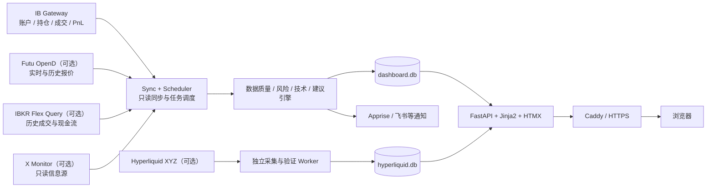

# 个人交易决策系统（IBKR）

[English](README.md) | [简体中文](README.zh-CN.md)

[](https://github.com/datazhy/ibkr-trading-decision-system/actions/workflows/ci.yml)


[](LICENSE)

自托管、面向个人投资者的美股交易决策、风险控制与复盘系统（界面名称：**小鱼交易台**）。

系统从 IBKR 读取账户、持仓、成交与盈亏数据，结合行情、技术指标、风险规则和个人交易计划，形成一条可审计的决策链：

> **同步账户 → 校验数据 → 评估风险 → 生成建议 → 人工执行 → 复盘结果**

系统可以给出加仓、减仓、持有、止损、不追涨等操作倾向及仓位建议，但**不会调用任何下单、撤单或转账接口**。所有真实交易均由用户在券商端手工确认和执行。

> [!IMPORTANT]
> “只读”指系统对券商账户只读。自选池、交易计划、日记、事件状态等内容会写入本地 SQLite 数据库。

## 核心能力

- **只读账户同步**：同步 IBKR 账户、持仓、订单、成交、PnL、保证金与历史日线。
- **交易建议闭环**：把账户风险、技术状态、市场环境和现有计划合成为可解释建议，并跟踪人工执行结果。
- **规则化风险控制**：R1–R7 风控规则、组合风险评分、风险事件、通知节流与恢复提醒。
- **机会发现与组合构建**：维护个人自选池，扫描趋势突破与健康回踩，按风险预算生成组合草案。
- **收益与对账**：区分当日盈亏、已实现盈亏、未实现盈亏、现金流和资金加权收益，支持 Flex Query 回补。
- **技术与市场环境**：跟踪持仓技术面、EMA 周期、止损结构、VIX/VXN、QQQ、SOX 与利率环境。
- **每日简报与信息流**：生成确定性或 AI 辅助风险简报，聚合 X 信息流并保留来源与生成审计。
- **历史复盘**：事件复盘、阈值效果、历史重放、执行匹配和持仓周期归档。
- **链上影子情报**：可选采集 Hyperliquid XYZ 公共数据，独立验证钱包与信号质量；默认不影响主交易建议。
- **可运维性**：能力状态、数据新鲜度、批次溯源、watchdog、自愈、心跳与双库热备。

## 功能板块

| 板块 | 路径 | 主要内容 |
|---|---|---|
| 概览与持仓决策 | `/` | 净资产、收益、风险摘要、持仓、建议、交易纪律与持仓计划入口 |
| 机会发现 | `/opportunities` | 自选池、候选评分、机会扫描、组合提案、采纳与 5/10/20/40 日结果 |
| 链上情报 | `/hyperliquid` | XYZ 资产映射、钱包、信号、结果、验证状态与数据质量 |
| 成交历史 | `/history` | 成交明细、订单/成交/决策口径、佣金、对账与 CSV 导出 |
| 收益分析 | `/cashflow`、`/calendar` | 资金流、真实收益曲线、归因、月历与年度汇总 |
| 风险事件 | `/events`、`/reviews` | 事件时间线、确认/抑制、事后结果与复盘队列 |
| 技术面与规则 | `/technical`、`/rules` | 技术状态、止损质量、R1–R7 评估与通知记录 |
| 阈值与效果 | `/performance` | 规则命中效果、标签窗口、阈值回测与调整依据 |
| 历史重放 | `/replay` | 按事件时间回放历史数据，不污染实时事件与通知状态 |
| 每日简报 | `/briefs` | 简报正文、数据来源、校验结果、推送记录与调度审计 |
| X 信息流 | `/x` | 每日早报、推文流、关注来源与原文追溯 |
| 投资日记 | `/journal` | 手写记录与持仓周期归档；归档内容只读 |
| 口径说明 | `/reference` | 盈亏、计数、佣金和风控规则的统一定义 |
| 系统状态 | `/status` | 数据新鲜度、连接能力、调度器、watchdog 与同步批次 |

## 系统架构



主账户链路与 Hyperliquid 链路使用独立数据库和独立调度执行器。链上服务故障不会拉低 IBKR 主链路状态，也不会阻塞账户同步。

## 安全边界

系统通过多层约束保持券商侧只读：

1. `ib.connect(readonly=True)`：IB API 连接明确启用只读模式。
2. `IB_READONLY=yes`：IB Gateway 容器启用 Read-Only API。
3. 建议使用 IBKR **只读子用户**登录 Gateway。
4. 代码不提供下单、撤单或转账路由；交易计划仅写入本地数据库。
5. 历史重放使用显式只读上下文，不发送通知，也不推进实时事件状态。

敏感信息与运行数据不会进入 Git：

- `.env`、`secrets/`、Token、密钥与证书；
- `data/`、`backups/`、SQLite 数据库和日志；
- IBKR 账户号等敏感字段在落库前使用 Fernet 加密。

## 风控规则 R1–R7

每轮持仓同步后都会评估规则，并将状态、证据、数据批次与触发记录写入数据库。通知只在状态变化、显著恶化或恢复时发送。

| 规则 | 含义 | 默认阈值 |
|---|---|---|
| R1 | 单标的集中度过高 | 市值占净资产 `> 30%` |
| R2 | 板块集中度过高 | 同板块占净资产 `> 40%` |
| R3 | 动用融资 | Margin 余额 `< 0` |
| R4 | 当日同标的反复增加风险 | 同标的风险增加决策 `≥ 2` 次/日 |
| R5 | 月度交易过频 | 主动交易决策 `> 10` 次/月 |
| R6 | 单次认亏过大 | 决策级已实现亏损 `> 净资产 2%`，进入 48 小时冷静期 |
| R7 | 触及建议止损位 | 现价穿越 ATR / swing 止损线 |

所有阈值集中在规则配置中，页面实时读取，不在模板中写死。R6 按一次交易决策聚合部分成交；R7 在行情质量不足时返回未判定，不使用冻结价制造“未触发”的假象。

## 机会发现与组合构建

机会模块面向美股普通股多头，默认目标持有周期为 2–12 周：

1. 从个人自选池读取标的；
2. 过滤数据完整性、价格、流动性、市场环境和止损质量；
3. 对趋势突破与健康回踩进行评分；
4. 按净资产、现有持仓和风险预算生成组合提案；
5. 用户采纳后仅创建 `PENDING` 持仓周期和 `DRAFT` 操作计划。

默认组合边界包括：单笔风险 0.75%、目标单仓上限 20%、板块上限 35%、最多 8 只持仓、至少保留 5% 现金且不使用 Margin。

该模块按两阶段启用：

```dotenv
OPPORTUNITY_ENABLED=false
PORTFOLIO_BUILDER_ENABLED=false
OPPORTUNITY_SHADOW_MIN_DAYS=5
```

先开启候选扫描并完成至少 5 个有效交易日的影子观察，再开启组合构建。服务端会校验观察门槛，误开开关也不能绕过。

## Hyperliquid XYZ 影子情报

Hyperliquid 模块用于研究链上美股映射资产的价格发现与钱包行为，采用独立数据链路：

- 采集 XYZ 元数据、公共成交、资金费、钱包账本与 mark/oracle 上下文；
- 对现实美股映射、流动性、价差、数据缺口和时间点一致性执行质量门禁；
- 分别评估日内与波段信号，并使用现实正股与 SPY 行情计算结果；
- 通过 `SHADOW → ELIGIBLE → ACTIVE / SUSPENDED` 状态机管理晋级；
- 只有验证通过并经人工批准的 `ACTIVE` 版本，才允许单调收紧现有建议。

所有链上功能默认关闭。推荐从纯采集开始：

```dotenv
HYPERLIQUID_ENABLED=true
HL_COLLECTOR_ENABLED=true
HL_WALLET_SCORING_ENABLED=false
HL_SIGNAL_SHADOW_ENABLED=false
HL_INTRADAY_ALERTS_ENABLED=false
HL_SWING_INFLUENCE_ENABLED=false
```

公开版上线门槛、隔离原则和回滚方式见 [中文部署指南](docs/zh-CN/deployment.md)。

## 技术栈

| 层级 | 技术 |
|---|---|
| 后端 | Python 3.11+、FastAPI、APScheduler、ib_async |
| 前端 | Jinja2、HTMX、原生 CSS / JavaScript |
| 数据 | SQLite、WAL、Fernet 加密、gzip 热备份 |
| 行情与外部数据 | IBKR、Futu OpenD（可选）、Flex Query（可选）、Hyperliquid（可选） |
| 通知 | Apprise（飞书等渠道）与 healthchecks.io 心跳 |
| 部署 | Docker Compose、IB Gateway、Caddy、systemd watchdog |
| 测试 | pytest、freezegun、FastAPI TestClient |

## 快速开始

### 前置条件

- Docker Engine 与 Docker Compose；
- IBKR 账户，以及用于 Gateway 登录的用户名、密码和 TOTP Secret；
- 一个 Fernet 密钥，用于本地敏感字段加密；
- 公网部署时需要域名和 Cloudflare DNS API Token。

建议为 IBKR 单独创建只读子用户，不要直接使用主用户。

### 1. 准备配置

```bash
cp .env.example .env
chmod 600 .env
python -c 'from cryptography.fernet import Fernet; print(Fernet.generate_key().decode())'
```

把生成结果写入 `.env` 的 `ACCOUNT_ENC_KEY`，并至少填写：

```dotenv
TWS_USERID=
TWS_PASSWORD=
TOTP_KEY=
ACCOUNT_ENC_KEY=
```

如果要通过 Caddy 对外提供 HTTPS，再填写 `DASHBOARD_SITE` 与 `CF_API_TOKEN`。完整配置及默认值见中文注释版 [.env.example.zh-CN](.env.example.zh-CN)，英文默认版见 [.env.example](.env.example)。

### 2. 初始化数据库

```bash
docker compose build
docker compose run --rm web python manage.py init
```

公网部署前建议启用应用登录：

```dotenv
DASHBOARD_AUTH_ENABLED=true
DASHBOARD_AUTH_USER=admin
```

然后设置密码：

```bash
docker compose run --rm web python manage.py webpass
```

### 3. 启动服务

仅启动看板、备份和 HTTPS 入口（读取已有数据库，不启动 IBKR 同步）：

```bash
docker compose up -d --build web backup caddy
```

启动完整 IBKR 只读链路：

```bash
docker compose --profile live up -d --build
docker compose --profile live ps
```

访问 `https://<DASHBOARD_SITE>`。IB Gateway 首次启动可能需要几分钟完成下载和 TOTP 登录。

### 4. 验证状态

```bash
docker compose exec web python manage.py status
docker compose exec web python -c \
  'import urllib.request; print(urllib.request.urlopen("http://127.0.0.1:8000/healthz").read().decode())'
curl -fsS https://<DASHBOARD_SITE>/healthz
```

容器内 `8000` 端口默认不发布到宿主机；第二条命令验证容器内部健康，第三条验证公网入口。

## 常用命令

```bash
python manage.py init          # 初始化数据库
python manage.py status        # 查看持仓、现金、Margin 与连接状态
python manage.py resync        # 手工补同步并立即评估规则
python manage.py daily-bars    # 回补持仓历史日线与长周期指标
python manage.py flex          # Flex Query 回补历史成交与资金流
python manage.py cashflow ...  # 追加式登记、冲正和核对现金流
python manage.py webpass       # 设置看板登录密码
```

在 Docker 环境中，可将命令改为 `docker compose exec web python manage.py ...`；需要连接常驻同步链路的操作建议在 `sync` 容器执行。

## 关键配置

| 配置组 | 主要变量 | 说明 |
|---|---|---|
| IBKR | `TWS_*`、`IB_*` | Gateway 登录、账户、Client ID 与行情类型 |
| 行情 | `FUTU_*`、`MARKET_*` | 富途报价回退与市场环境指标 |
| 实时同步 | `LIVE_*`、`*_SYNC_INTERVAL` | 页面态、快照、成交与校准频率 |
| 风控 | `RISK_*`、`ALERT_*`、`DQ_*` | 风险阈值、通知配额与数据质量门禁 |
| 收益 | `FLEX_*`、`DAILY_PNL_*` | Flex 回补、资金流与 PnL 可靠性 |
| 简报 | `BRIEF_*`、`AI_*` | 生成时间、模型与超时；无 API Key 时使用确定性模板 |
| 机会 | `OPPORTUNITY_*`、`PORTFOLIO_*` | 扫描、评分、影子观察与组合风险边界 |
| 链上 | `HYPERLIQUID_*`、`HL_*` | 独立采集、回溯、评分、信号、通知与保留策略 |
| Web | `DASHBOARD_*` | 域名、应用登录和会话有效期 |

修改代码后必须重新构建镜像，因为 `app/` 是通过 `COPY` 写入镜像，不是运行时挂载：

```bash
docker compose --profile live up -d --build
```

## API

JSON API 统一位于 `/api/v1`，主要覆盖：

- 账户快照、同步状态、持仓计划与建议；
- 风险评估、风险事件、趋势、通知、回测与历史重放；
- 市场环境、收益、现金流、对账与归因；
- 每日简报、机会扫描、组合提案与结果；
- Hyperliquid 状态、资产、钱包、信号、结果和验证。

运行后可访问 `/docs` 查看 FastAPI 自动生成的接口文档。启用 `DASHBOARD_AUTH_ENABLED` 后，页面与 API 共用登录保护。

## 项目结构

```text
.
├── app/
│   ├── api.py                    # JSON API
│   ├── webapp.py                 # Web 路由与认证
│   ├── sync.py / scheduler.py    # 同步与调度
│   ├── rules.py / risk_*.py      # 风控规则、评分、事件与趋势
│   ├── recommendation_service.py # 建议合成
│   ├── position_plans.py         # 持仓周期与执行计划
│   ├── opportunity_service.py    # 机会扫描与组合构建
│   ├── hyperliquid_*.py          # 链上采集、验证与结果
│   ├── schema.sql                # 主数据库结构
│   └── templates/                # Jinja2 / HTMX 页面
├── config/sectors.json           # 标的板块映射
├── deploy/                       # Caddy 与 systemd 服务
├── docs/                         # 设计、审计和部署文档
├── scripts/                      # 备份、watchdog、预检与质量报告
├── tests/                        # 单元、集成与回归测试
├── docker-compose.yml
├── manage.py
└── requirements.txt
```

## 测试与发布前检查

安装依赖后运行完整测试：

```bash
python -m pytest -q
python scripts/check_repository_hygiene.py
```

Docker 配置与部署预检：

```bash
docker compose config >/dev/null
PYTHONPATH=. python scripts/deploy_preflight.py --mode shadow
```

如果使用独立版 Compose，请把示例中的 `docker compose` 替换为 `docker-compose`。

测试重点覆盖盈亏与计数口径、只读边界、市场时段、数据质量、建议溯源、机会组合、历史重放、Web 页面、备份恢复和 Hyperliquid 验证门禁。

## 数据可靠性与运维

- **数据质量闸门**：数据缺失、过期或口径不完整时明确降级，不写零快照凑结果。
- **同步批次溯源**：账户、持仓、行情和规则评估共享 `sync_run_id`，便于跨页面核对。
- **四层 watchdog**：检查容器、端口、IB API 握手和数据新鲜度。
- **受控自愈**：连续失败才重启，并限制冷却时间和每小时重启次数。
- **外部心跳**：同步成功后可向 healthchecks.io 发送 dead man's switch 心跳。
- **独立热备**：`dashboard.db` 与 `hyperliquid.db` 分别执行 SQLite 在线备份、压缩与完整性检查。
- **更新窗口**：交易周内同步与提醒，休市窗口暂停无意义的刷新和通知。

watchdog 安装说明见 [deploy/risk-watchdog.timer](deploy/risk-watchdog.timer)，公开部署说明见 [中文部署指南](docs/zh-CN/deployment.md)。

## 数据口径原则

- **三种盈亏不可相加**：当日盈亏、已实现盈亏和持仓未实现盈亏属于不同时间口径。
- **三种计数不可混用**：`order`、`execution`、`decision` 分别表示订单、成交回报和主动决策。
- **资金流不反推**：无法从账户净值跳变可靠推导入金/出金；优先使用 Flex Query 或人工登记。
- **不足以计算就明确缺失**：样本、行情或来源不足时显示 `INSUFFICIENT_DATA`、`STALE` 或 `LIMITED`，不生成伪精确结果。
- **历史回放遵守事件时间**：历史时点只能读取当时已经存在的数据，避免前视偏差。

## 相关文档

- [中文文档索引](docs/zh-CN/README.md)
- [架构与安全模型](docs/zh-CN/architecture.md)
- [部署指南](docs/zh-CN/deployment.md)
- [英文文档索引](docs/README.md)

## 隐私与安全

不要提交 `.env`、Webhook、API Token、TOTP Secret、私钥、云凭据、数据库、日志、账户快照、持仓、成交、钱包观察名单、生产域名或服务器生成报告。仓库默认忽略这些路径；公开 fork 前仍应同时扫描当前文件树与 Git 历史。

## 已知限制

- IBKR 免费行情通常有约 15 分钟延迟；延迟行情下的止损提醒不会提升为最高严重度。
- 资金流自动化依赖 Flex Query；未配置时需要人工登记入金和出金。
- Futu OpenD 仅作为报价与历史行情来源，账户、持仓、成交和 PnL 始终以 IBKR 为准。
- 机会与 Hyperliquid 模块都需要先通过影子观察和质量门禁，不应直接作为生产交易依据。
- 本项目是个人决策辅助系统，不是自动交易机器人，也不保证盈利。

## 许可证

本项目采用 [MIT License](LICENSE) 开源。Copyright © 2026 datazhy。

## 免责声明

本项目仅用于个人数据整理、风险控制与交易复盘，不构成投资建议、招揽或收益承诺。任何交易决策及其结果均由使用者自行承担。
